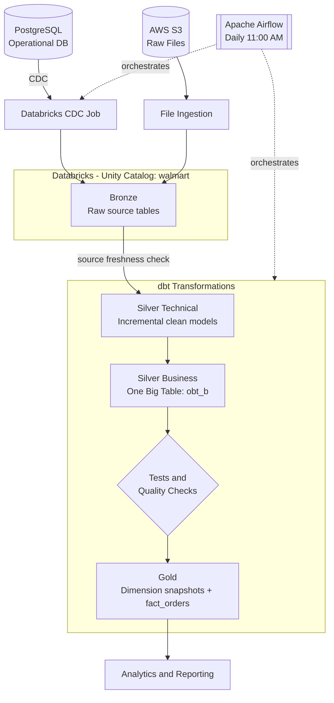

# Walmart Data Engineering Pipeline


> A daily, Airflow-orchestrated CDC pipeline that moves Walmart retail data from PostgreSQL and S3 through Databricks Bronze, Silver and Gold layers, with dbt transformations, snapshots and data quality tests.

The pipeline ingests data from operational sources, processes incremental changes, transforms data through analytical layers, and validates the results before they are made available for reporting.

## Table of Contents

1. [Architecture](#architecture)
2. [Data Sources](#data-sources)
3. [Change Data Capture](#change-data-capture)
4. [File Ingestion](#file-ingestion)
5. [Databricks Processing](#databricks-processing)
6. [dbt Transformation Layers](#dbt-transformation-layers)
7. [Data Quality Checks](#data-quality-checks)
8. [Airflow Orchestration](#airflow-orchestration)
9. [Pipeline Runtime](#pipeline-runtime)
10. [Technology Responsibilities](#technology-responsibilities)

## Architecture



Apache Airflow orchestrates and monitors every stage of this flow.

## Data Sources

| Source | Role |
|---|---|
| PostgreSQL (operational DB) | Stores operational data and emits change data through CDC |
| AWS S3 | Stores raw files that are processed into Databricks |

> The exact ingestion implementations for these sources are external to this repository and run inside Databricks.

## Change Data Capture

Changes in PostgreSQL are captured using CDC. Instead of repeatedly loading entire tables, the pipeline processes only inserted or updated records.

An existing Databricks job handles CDC ingestion and publishes the resulting records into Databricks tables. The Airflow DAG triggers this job using the Databricks SDK and waits for it to finish before continuing.

## File Ingestion

Data stored in AWS S3 is read by a Databricks ingestion process. Raw files are loaded into the **Bronze** layer, where they are available for validation and transformation. S3 ingestion may run as part of the Databricks job triggered by Airflow.

## Databricks Processing

Databricks performs ingestion and incremental processing, and maintains the data in Unity Catalog:

```text
Catalog: walmart
Bronze:   Raw source tables
Silver:   Cleaned and joined tables
Gold:     Dimensional and fact models
```

Source tables: `orders`, `customers`, `products`, `order_items`, `stores`, `employees`.

## dbt Transformation Layers

dbt connects to Databricks and transforms the data using SQL models.

### Bronze

Raw source tables:

```text
walmart.bronze.orders
walmart.bronze.customers
walmart.bronze.products
walmart.bronze.order_items
walmart.bronze.stores
walmart.bronze.employees
```

dbt source freshness is checked before downstream transformations begin.

### Silver Technical

Incrementally cleans and standardizes the source tables.

Models: `customers_t`, `employees_t`, `order_items_t`, `orders_t`, `products_t`, `stores_t`.

Most models use incremental loading and only update records newer than those already in the target table:

```sql

WHERE updated_timestamp >
    (
        SELECT COALESCE(MAX(updated_timestamp), '1900-01-01')
        FROM {{ this }}
    )

```

Models are stored as tables and use `processed_at` columns to record when each row was transformed.

### Silver Business

The `obt_b` model joins the technical models into a denormalized **One Big Table**:

- Orders
- Customers
- Order items
- Products
- Employees
- Stores

This lets downstream analytics avoid complex joins.

### Gold

The Gold layer contains analytical models:

- Ephemeral order, customer, employee, product, and store models
- Dimension snapshots for slowly changing records (tracked via `updated_timestamp`)
- `fact_orders`, containing IDs and measures used for order analysis

## Data Quality Checks

dbt tests validate the Silver and analytical models:

- Unique values
- Non-null values
- Product prices greater than zero
- Required IDs present in the One Big Table

The custom `test_obt.sql` test warns when important identifiers such as `order_id`, `customer_id`, or `product_id` are missing.

## Airflow Orchestration

The `orchestrate` DAG runs **daily at 11:00 AM**:

1. Trigger the Databricks CDC ingestion job
2. Wait until the Databricks job finishes successfully
3. Remove the previous dbt target directory
4. Check source freshness
5. Run Silver technical models
6. Test Silver technical models
7. Run the Silver business model
8. Test the Silver business model
9. Run the Gold ephemeral models
10. Run dbt snapshots for dimensions
11. Create the Gold fact model

```text
Databricks CDC ingestion
        ↓
Clean dbt target
        ↓
Check source freshness
        ↓
Run Silver technical models
        ↓
Test Silver technical models
        ↓
Build Silver business model
        ↓
Test Silver business model
        ↓
Build Gold ephemeral models
        ↓
Run dimension snapshots
        ↓
Build Gold fact model
```

## Pipeline Runtime

The project runs with Docker Compose as an Airflow cluster, including:

- Airflow API server
- Scheduler
- DAG processor
- Celery workers
- Redis (task broker)
- PostgreSQL (Airflow metadata database)
- Triggerer
- Optional Flower monitoring service

The custom Docker image installs the required dbt and Databricks packages.

## Technology Responsibilities

| Technology | Responsibility |
|---|---|
| PostgreSQL | Operational database source |
| AWS S3 | Raw file storage source |
| Databricks | CDC and file ingestion, incremental processing, storage |
| dbt | SQL transformations, incremental models, snapshots, tests |
| Apache Airflow | Scheduling, dependency management, job monitoring, orchestration |
| Docker | Local deployment of the Airflow environment |
| PostgreSQL (metadata) | Stores Airflow state and task history |
